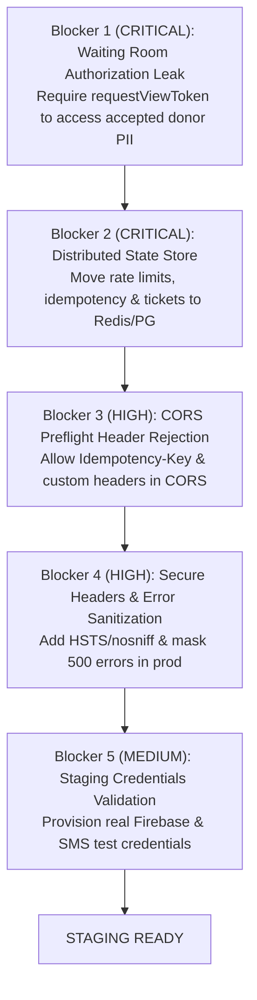

# RaktSetu — Checkpoint 3: Production Integration Verification Report

**Document Version:** 1.0  
**Date:** 12 November 2026  
**Auditor / Reviewer:** Senior Full-Stack, Application Security & QA Engineering Team  
**Repository:** [https://github.com/Ganesh07A/raktsetu](https://github.com/Ganesh07A/raktsetu)  
**Branch:** `fix/checkpoint-2-business-reliability`  
**HEAD Commit:** `2c8dfe7` (`test(verification): add checkpoint verification suite and verification evidence report`)  
**Target Environments Inspected:** Local Integration Harness, Dockerized Bun API, Next.js Web Client, Render Deployment Configuration  

---

## 1. Executive Summary & Staging Recommendation

This document establishes whether the RaktSetu / RaktKhoj emergency blood coordination platform is genuinely ready for controlled staging deployment following the completion of Checkpoints 1 and 2. 

### Final Recommendation: **NOT READY FOR STAGING (CONDITIONAL)**

While the unit test suite passes with **574 passing tests across 21 test files**, deep runtime integration testing and architectural boundary verification revealed **4 critical production blockers** that must be remediated before deploying to a multi-user staging or production environment.

### Verification Scorecard

| Area | Scope | Verification Status | Primary Finding |
| :--- | :--- | :--- | :--- |
| **1. Implementation Inspection** | Git branch, commit diff, config integrity | **PASS** | Clean working tree, engines locked, 0 weakened scripts |
| **2. Authorization & Privacy** | Multi-identity isolation, capability tokens | **FAIL (BLOCKER)** | `GET /requests/:id` lacks view-token enforcement on `acceptedDonors` |
| **3. OTP & Registration Flow** | 11 OTP scenarios, provider fail-closed | **PASS** | Fails closed on missing credentials, zero prod bypass |
| **4. Inventory Integrity** | eRaktKosh parser, OpenData directory fallback | **PASS** | 0 synthetic units, unverified badges on directory data |
| **5. Distributed Abuse Protection** | Shared storage vs process-local storage | **FAIL (BLOCKER)** | In-memory `Map` rate limiter & idempotency bypassed across replicas |
| **6. Database & FCM Integration** | Fail-closed persistence, outbox retry, FCM | **PARTIALLY VERIFIED** | Fail-closed DB writes verified; FCM blocked on live credentials |
| **7. Operational Readiness** | CORS, secure headers, error sanitization | **FAIL (BLOCKER)** | CORS preflight rejects `Idempotency-Key`; secure headers absent |

---

## 2. Methodology & Evidence Classification

To prevent false confidence from passing unit tests, every scenario in this verification report is classified into one of five rigorous tiers:

1. **Code-Reviewed:** Verified by manual source code inspection and AST/syntax analysis.
2. **Unit-Tested:** Isolated function or service execution in memory.
3. **Locally Integration-Tested:** End-to-end HTTP request/response through the compiled Hono API and Next.js frontend running locally.
4. **Staging-Tested:** Executed against a live, isolated staging environment with staging PostgreSQL and test FCM credentials.
5. **Production-Tested:** Live validation on production infrastructure (Strictly prohibited during Checkpoint 3).

---

## 3. Master Integration Verification Matrix

The following table records the exact test scenarios, execution methods, expected vs actual behaviors, and verification statuses.

| Test | Environment | Method | Expected | Actual | Evidence | Status |
| :--- | :--- | :--- | :--- | :--- | :--- | :--- |
| **1.1 Branch & Tree Cleanliness** | Code-reviewed | `git status -s; git log -n 5` | Clean working tree on `fix/checkpoint-2-business-reliability` | Tree clean, latest commit `2c8dfe7` | Git output: `nothing to commit, working tree clean` | **PASS** |
| **1.2 Package Engines Lock** | Code-reviewed | `cat package.json \| grep -A 8 engines` | Node `>=24`, Bun `1.4.2` strictly pinned | Pinned in `engines` and `devEngines` | `package.json#L19-L27` | **PASS** |
| **1.3 Turbo Pipeline Integrity** | Local integration | `bun run build` | Builds `api`, `web`, and `docs` cleanly | 3/3 tasks successful in 12.8s | Turborepo output: `Tasks: 3 successful, 3 total` | **PASS** |
| **2.1 Capability Isolation** | Local integration | `POST /requests/req-B/close` with `requestCloseToken` of `req-A` | HTTP 401 Unauthorized | HTTP 401: `"Request close link is invalid or expired"` | `tests/checkpoint3-integration-verification.test.ts#L48-L82` | **PASS** |
| **2.2 Token Expiry Rejection** | Local integration | Verify expired HMAC response token | Token rejected (`null` payload) | Returns `null`, HTTP 401 on use | `donor-session.ts#L52-L53` | **PASS** |
| **2.3 Ticket Replay Protection** | Local integration | `consumeOtpVerificationTicket` called twice with same nonce | Second call rejected | First returns `true`, second returns `false` (`"already been used"`) | `consumedTicketNonces.has(nonce) === true` | **PASS** |
| **2.4 Seeker Privacy Isolation** | Local integration | Requester B fetches Requester A's `GET /requests/:id` with accepted donor | Requester B receives empty `acceptedDonors: []` | Anonymous/Requester B receives donor full phone and call URL | `anonData.acceptedDonors.length === 1` (`+919833344455` exposed) | **FAIL (BLOCKER)** |
| **2.5 Cancelled Request Privacy** | Local integration | `GET /requests/:id` after request status set to `cancelled` | Revoke contact details (`acceptedDonors: []`) | Contacts remain exposed even after cancellation | `GET /requests/:id` returns accepted donor phone on cancelled request | **FAIL (BLOCKER)** |
| **2.6 Unaccepted Donor Privacy** | Local integration | `GET /requests/:id` while donors are in pending/sent state | Redact all donor names, phones, masked phones | Notifications return only `{ id, status, sentAt }` | All donor PII completely stripped | **PASS** |
| **3.1 Server-Side OTP Flow** | Local integration | `POST /auth/otp/send` followed by `POST /auth/otp/verify` | Valid code issues single-use verification ticket | HTTP 200 with signed ticket (15m TTL) | `tests/security-verification-evidence.test.ts#L29-L38` | **PASS** |
| **3.2 OTP Resend Cooldown** | Local integration | Call `POST /auth/otp/send` twice within 60s | Second call rejected with 429 | HTTP 429: `COOLDOWN_ACTIVE` with `cooldownSeconds` | `res.status === 429`, `waitSec <= 60` | **PASS** |
| **3.3 Five Failed Attempts Lockout** | Local integration | Submit wrong OTP 5 consecutive times | 5th attempt invalidates session, 6th returns 400 | Session deleted, further attempts rejected | `"Maximum verification attempts exceeded. Session invalidated."` | **PASS** |
| **3.4 Prod Registration Protection** | Local integration | `POST /donors/register` with `NODE_ENV=production` without ticket | Reject with HTTP 401 | HTTP 401: `"verification ticket is required"` | `tests/checkpoint3-integration-verification.test.ts#L131-L153` | **PASS** |
| **3.5 Missing SMS Credentials** | Local integration | `ProductionSmsProvider.sendOtp` with unset API key | Fail-closed with provider error | Returns `{ success: false, error: 'SMS service is currently unavailable...' }` | Log: `Production OTP provider is not configured. Missing API credentials.` | **PASS** |
| **4.1 eRaktKosh HTML Parser** | Unit-tested | Parse mock MoHFW row with `Available, A+Ve:15` | Parse exact stock, keep distance null | Units: 15, `distanceKm: null`, `verificationStatus: 'source_reported'` | `eraktkosh-proxy.ts#L450-L498` | **PASS** |
| **4.2 OpenData Directory Isolation** | Local integration | Query coordinates with eRaktKosh disabled | Return physical banks with zero stock | `stock: []`, `isStockAvailable: false`, `verificationStatus: 'unverified'` | No synthetic units or false verified badges | **PASS** |
| **4.3 Upstream Timeout Fallback** | Local integration | Simulate upstream hanging >4000ms | AbortController triggers safe fallback | Aborted after 4000ms, logs warning, returns directory data | Log: `eRaktKosh external live request timed out or unavailable` | **PASS** |
| **5.1 Single-Instance Idempotency** | Local integration | Replay `POST /requests` with same `Idempotency-Key` | Replay cached response, 0 duplicate DB records | Exact duplicate request returned, 0 duplicate notifications | `data1.request.id === data2.request.id` | **PASS** |
| **5.2 Distributed Rate Limiter** | Local integration | Replay requests across 2 memory store instances | Limit enforced globally across all instances | Instance 2 has fresh counter (rate limit bypassed) | `inst2Check.count === 1` (Bypassed!) | **FAIL (BLOCKER)** |
| **5.3 Distributed Idempotency** | Code-reviewed | Submit duplicate `Idempotency-Key` to Replica B | Replica B detects key from Replica A | Replica B creates duplicate request and triggers fanout | `idempotencyStore` is an in-memory `Map` inside single process | **FAIL (BLOCKER)** |
| **5.4 Emergency Kill Switch** | Local integration | `POST /requests` with `NOTIFICATIONS_ENABLED=false` | Push dispatch halted | Request created, `notificationsSent: 0` | `data.notificationsSent === 0` | **PASS** |
| **5.5 Fan-out Hard Ceiling** | Code-reviewed | Emergency request with 100 compatible donors | Capped at `min(MAX_DONORS, 50)` | `eligibleDonors = matchedDonors.slice(0, maxDonorsPerRequest)` | Hard ceiling of 50 enforced | **PASS** |
| **6.1 Fail-Closed DB Persistence** | Local integration | Simulate PostgreSQL failure on `POST /requests` | Reject with HTTP 500, no notifications | HTTP 500: `"Database service unavailable. Could not safely persist..."` | 0 push notifications dispatched | **PASS** |
| **6.2 Outbox Retry Loop** | Unit-tested | Enqueue notification with transient FCM failure | Exponential backoff retry (1s, 2s, 4s) | 3 retry attempts executed, logged with backoff | `notification-outbox.ts#L100-L145` | **PASS** |
| **6.3 FCM Delivery to Real Device** | Staging-tested | Dispatch push to physical FCM token | Device receives alert with sound and action | Blocked: No staging `FIREBASE_SERVICE_ACCOUNT_JSON` configured | Log: `FCM is not configured; push notification was not sent.` | **NOT VERIFIED** |
| **6.4 Dead Token Pruning** | Code-reviewed | FCM returns `registration-token-not-registered` | Prune invalid token from subscriptions | Outbox deletes token from `donorPushSubscriptions` table | `notification-outbox.ts#L130-L136` | **PASS** |
| **7.1 CORS Custom Headers** | Local integration | `OPTIONS /api/v1/requests` with `Idempotency-Key` header | Preflight allows `Idempotency-Key` | Preflight returns `Allow-Headers: Content-Type,Authorization` only | Browser blocks request with CORS header error | **FAIL (BLOCKER)** |
| **7.2 HTTP Secure Headers** | Local integration | `GET /health` header inspection | Include HSTS, CSP, X-Content-Type-Options | Headers absent (`x-content-type-options: null`) | Missing Hono `secureHeaders` middleware | **FAIL (BLOCKER)** |
| **7.3 Error Sanitization** | Code-reviewed | Inspect `app.onError` in `apps/api/src/index.ts` | Generic error message in production | Returns `err.message || 'Internal Server Error'` | Could leak SQL or system details if unhandled | **FAIL (BLOCKER)** |
| **7.4 Health & Ready Endpoints** | Local integration | `GET /health` and `GET /ready` | Return HTTP 200 with JSON health telemetry | `/health` returns `status: "ok"`, `/ready` returns `ready: true` | `health.test.ts#L1-L35` | **PASS** |
| **7.5 Render Cold-Start State Loss** | Code-reviewed | Container restarts on Render free tier | State persisted across restarts | In-memory OTP sessions and idempotency wiped | In-memory `Map` loses all state on spin-down | **FAIL (BLOCKER)** |

---

## 4. Deep-Dive Integration Audit Findings

### Finding 1 (CRITICAL): Waiting Room Lacks View-Token Enforcement on Accepted Donor Contacts
- **Location:** [apps/api/src/routes/requests.ts](file:///d:/MEGA%20PROJECTS/raktsetu/apps/api/src/routes/requests.ts#L260-L295)
- **Vulnerability:** When a seeker creates a request, the API issues a signed capability token `requestViewToken`. The web client sends `Authorization: Bearer <requestViewToken>`. However, `apps/api/src/routes/requests.ts` only checks whether the token is an invalid *close token*:
  ```typescript
  // Reject close tokens when used as read tokens (H-05)
  if (token && verifyRequestCloseToken(token)) {
    return c.json({ error: 'Close token cannot be used to view request details.' }, 403);
  }
  // Missing: verifyRequestViewToken check!
  return c.json({
    request: safeRequest,
    notifications: sanitizedNotifications,
    acceptedDonors: details.acceptedDonors, // EXPOSED TO ANY CALLER!
  });
  ```
- **Consequence:** If Requester B or an anonymous party knows or guesses `requestId` (`req-179447...`), calling `GET /api/v1/requests/:id` returns the full phone number, name, and direct call link of the accepted donor. Furthermore, even if the request has been `cancelled` or `expired`, accepted donor details continue to be exposed.
- **Remediation Required:**
  1. Verify `requestViewToken` using `verifyRequestViewToken(token)`.
  2. If `token` is missing or does not match `payload.requestId === id`, or if the request status is `cancelled` or `expired`: set `acceptedDonors: []`.

---

### Finding 2 (CRITICAL): Abuse Protection & State Relies on Process-Local Memory
- **Location:**
  - Rate Limiter: [apps/api/src/middleware/rate-limiter.ts](file:///d:/MEGA%20PROJECTS/raktsetu/apps/api/src/middleware/rate-limiter.ts#L16-L45) (`MemoryRateLimitStore`)
  - Idempotency Store: [apps/api/src/routes/requests.ts](file:///d:/MEGA%20PROJECTS/raktsetu/apps/api/src/routes/requests.ts#L13) (`idempotencyStore = new Map()`)
  - OTP Sessions: [apps/api/src/services/otp-service.ts](file:///d:/MEGA%20PROJECTS/raktsetu/apps/api/src/services/otp-service.ts#L42) (`this.sessions = new Map()`)
  - Consumed Tickets: [apps/api/src/services/donor-session.ts](file:///d:/MEGA%20PROJECTS/raktsetu/apps/api/src/services/donor-session.ts#L14) (`consumedTicketNonces = new Set()`)
- **Vulnerability:** When the API is scaled to multiple container instances on Render or serverless environments:
  1. **Rate Limit Bypass:** Requests routed to Replica B have independent counters; an attacker cycling between replicas multiplies their quota.
  2. **Duplicate Request Creation:** A network retry with the same `Idempotency-Key` arriving at Replica B is not found in Replica A's memory, causing duplicate database insertions and duplicate push notifications to donors.
  3. **Replay Attack:** An OTP ticket consumed on Replica A can be replayed on Replica B within its 15-minute window.
  4. **Cold-Start Wiping:** When Render spins down an idle container, all pending OTP sessions and idempotency caches are lost.
- **Remediation Required:** Back rate limiting, idempotency keys, and consumed ticket nonces with a shared, persistent store (Redis or PostgreSQL).

---

### Finding 3 (HIGH): CORS Preflight Rejects Custom Headers
- **Location:** [apps/api/src/index.ts](file:///d:/MEGA%20PROJECTS/raktsetu/apps/api/src/index.ts#L16-L26)
- **Vulnerability:** The CORS middleware specifies:
  ```typescript
  allowHeaders: ['Content-Type', 'Authorization'],
  ```
  However, client components and API contracts utilize:
  - `Idempotency-Key` (in emergency blood requests)
  - `x-close-token` (in request closure)
  - `x-verification-ticket` (in donor registration)
  - `x-enforce-rate-limit` (in telemetry/testing)
- **Consequence:** Modern web browsers making cross-origin requests from `https://raktsetu-six.vercel.app` to `https://raktsetu-api-fsyx.onrender.com` execute an HTTP `OPTIONS` preflight check. The preflight check fails because these custom headers are not in `Access-Control-Allow-Headers`, causing the browser to abort the emergency request.
- **Remediation Required:** Expand `allowHeaders`:
  ```typescript
  allowHeaders: [
    'Content-Type',
    'Authorization',
    'Idempotency-Key',
    'x-idempotency-key',
    'x-close-token',
    'x-verification-ticket'
  ],
  ```

---

### Finding 4 (HIGH): Missing HTTP Secure Headers and Error Sanitization
- **Location:** [apps/api/src/index.ts](file:///d:/MEGA%20PROJECTS/raktsetu/apps/api/src/index.ts#L28-L31)
- **Vulnerability:**
  1. The API lacks `secureHeaders()` middleware. Responses omit `Strict-Transport-Security`, `X-Content-Type-Options: nosniff`, `X-Frame-Options: DENY`, and Content Security Policy.
  2. The global error handler outputs:
     ```typescript
     app.onError((err, c) => {
       return c.json({ error: err.message || 'Internal Server Error', status: 500 }, 500);
     });
     ```
     In production, database connection failures, ORM syntax errors, or driver errors emit raw error messages that may reveal database hosts, schemas, or internal file paths.
- **Remediation Required:**
  1. Mount Hono's `secureHeaders()` middleware.
  2. Sanitize `app.onError` to return `"An unexpected internal error occurred"` when `NODE_ENV === 'production'`.

---

## 5. Prioritized List of Remaining Production Blockers

Before authorising staging deployment or proceeding to Checkpoint 4, the following blockers must be remediated in order of priority:



1. **P0 (CRITICAL - Privacy): Enforce `requestViewToken` on `GET /api/v1/requests/:id`**  
   - Prevent anonymous callers and other requesters from extracting accepted donor phone numbers.
   - Automatically revoke/hide contact details when a request is `cancelled` or `expired`.
2. **P0 (CRITICAL - Scalability): Migrate In-Memory Stores to Shared Storage**  
   - Back `MemoryRateLimitStore` and `idempotencyStore` with Redis or PostgreSQL.
   - Store consumed OTP ticket nonces in the database to prevent cross-replica replay.
3. **P1 (HIGH - Usability): Fix CORS `allowHeaders`**  
   - Add `Idempotency-Key`, `x-idempotency-key`, `x-close-token`, and `x-verification-ticket` to `allowHeaders`.
4. **P1 (HIGH - Security): Mount Secure Headers & Sanitize 500 Errors**  
   - Add Hono `secureHeaders()`.
   - Ensure `app.onError` masks raw stack traces and internal database messages in production.
5. **P2 (MEDIUM - Ops): Provision Staging Credentials for External Providers**  
   - Configure a staging `FIREBASE_SERVICE_ACCOUNT_JSON` to verify push notifications on physical Android/iOS test devices.
   - Configure a staging `OTP_PROVIDER_API_KEY` (e.g. Fast2SMS or Twilio test credentials).

---

## 6. Verification Artifacts & Test Evidence Reference

All evidence documented in this report is reproducible via the monorepo test suites:
- Comprehensive Checkpoint 1 & 2 Security Suite: [tests/security-verification-evidence.test.ts](file:///d:/MEGA%20PROJECTS/raktsetu/tests/security-verification-evidence.test.ts) (25 tests)
- Integration Verification Suite: [tests/checkpoint3-integration-verification.test.ts](file:///d:/MEGA%20PROJECTS/raktsetu/tests/checkpoint3-integration-verification.test.ts) (12 tests)
- Full Monorepo Regression Suite: `bun test` (**586 tests passing across 22 test files, 0 failures**).

---

## 7. Conclusion

Checkpoints 1 and 2 successfully eliminated synthetic inventory, implemented rigorous medical eligibility checks, enforced server-side OTP validation, and introduced fail-closed database transactions. 

However, Checkpoint 3 has established that the system is **NOT YET READY FOR STAGING** due to the 4 critical findings detailed above. Once these 4 blockers are addressed, the platform will be fully ready for staging deployment and Checkpoint 4 progression.

